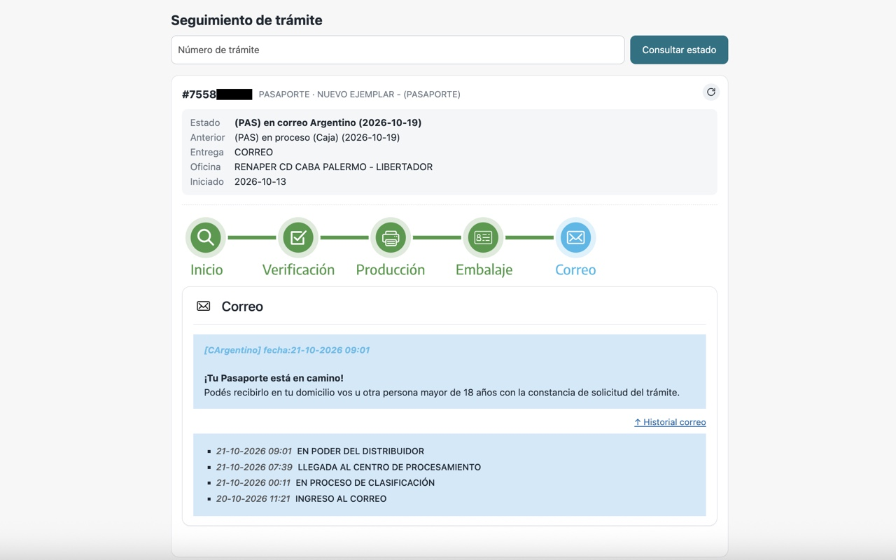

# Unofficial Mitramite Status Form

**EN** | [ES](README-ES.md) | [RU](README-RU.md)

**Install the extension, open https://mitramite.renaper.gob.ar/, and the lookup form is back.**

Chrome extension that restores the trámite status lookup form on https://mitramite.renaper.gob.ar/. The site's own form is no longer displayed, but its status service still works; this extension adds the form back and shows the stage progress, current status and tracking history.

**Not affiliated with, endorsed by or connected to RENAPER or the Argentine government.**

## Features

- Lookup form on the page: enter a trámite number and see its status.
- Progress stages (Inicio, Verificación, Producción, Embalaje, Correo), current and previous status, delivery method, office and filing date.
- Full tracking history, including postal service events.
- Remembers the numbers you looked up and suggests them when you focus the field; nothing is requested until you pick one.
- One-click refresh, responsive layout for small windows.
- The interface is in Spanish, like the site.

## Install

[**Install from the Chrome Web Store**](https://chromewebstore.google.com/detail/unofficial-mitramite-stat/afjbckgljnnaimdckbgaigfjnnmlobai), or install it manually from a ZIP below.

### From ZIP

1. Download `mitramite-form-<version>.zip` from the [latest release](https://github.com/vanekt/mitramite-form/releases/latest) and unzip it into a folder you will keep (do not delete or move it afterwards).
2. Open `chrome://extensions` and enable **Developer mode**.
3. Click **Load unpacked** and select the unzipped folder.

Works in Chrome 111+ and other Chromium-based browsers. Chrome may show a "disable developer mode extensions" notice on startup, and extensions installed this way do not update automatically.

## Usage

Install the extension, then open https://mitramite.renaper.gob.ar/, enter a trámite number and press the button.

## Privacy

The extension sends the number you enter to the site's own status service, exactly as the original form did, and collects nothing else. Saved numbers stay in your browser's local storage on that site and can be removed from the suggestions list. See [PRIVACY.md](PRIVACY.md).
